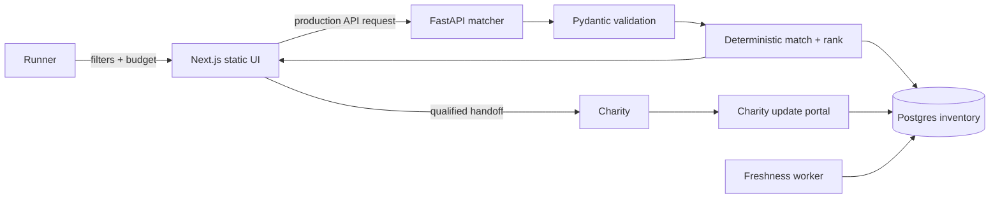

# Architecture

The published Pages demo is frontend-only and imports `data/demo_spots.json`; it never suggests that fixtures are live. `api/main.py` proves the same domain rules as runnable source. A production deployment would put FastAPI behind TLS, persist inventory in Postgres, authenticate charity editors, and record append-only status changes.

## Contracts and shadow paths

- `POST /matches`: validated race/cause/budget/verification request → sorted results. Nil optional filters mean no restriction; zero/too-small budget returns 422; no results returns `200` with an empty list; upstream persistence failure would return named `503 inventory_unavailable` in production.
- `POST /fundraising-plan`: known place and valid progress → remaining and weekly target. Unknown ID → 404; overfunded input → 422; invalid week count → 422.
- Demo UI: invalid plan fields show inline alerts; empty filters show recovery copy; matching action has disabled/loading state; navigation preserves local demo state only.

## Security and observability

Public reads contain no runner PII. Production writes require charity-scoped authorization, schema validation, rate limits, audit events, and allowlisted outbound link destinations. Metrics: inventory freshness p50/p95, stale-listing rate, API error rate, introduction conversion, corrections, and charity response time. Alert when >5% of active listings exceed freshness SLA or API 5xx exceeds 1% for 5 minutes.
